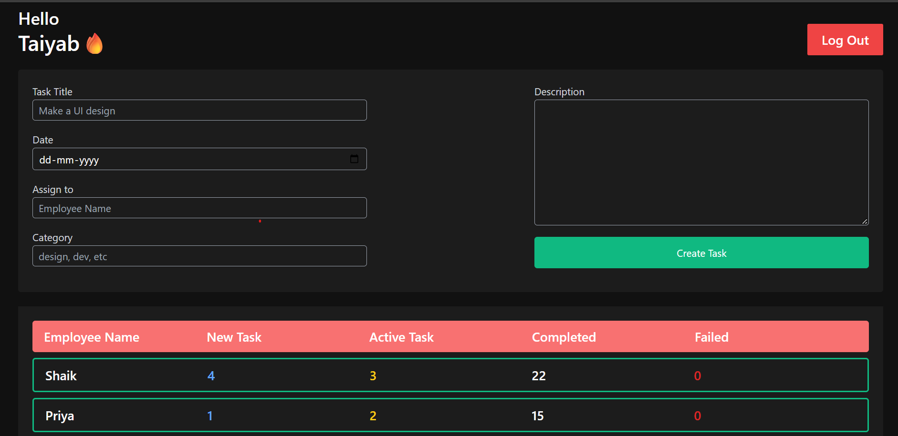
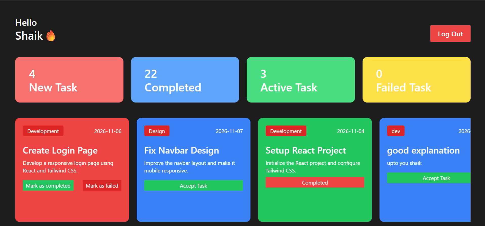

# Employee Management System (EMS)

A React-based Employee Management System that provides separate Admin and Employee dashboards for managing tasks and monitoring employee task progress.

## 🚀 Live Demo

[View Live Project](ADD_YOUR_VERCEL_URL_HERE)

## 📌 GitHub Repository

[Employee Management System](https://github.com/Taiyab7/Employee-Management-System)

## ✨ Features

### Admin Dashboard
- Admin login
- Create and assign tasks to employees
- View employee task statistics
- Monitor New, Active, Completed and Failed tasks
- Track employee task progress

### Employee Dashboard
- Employee login
- View assigned tasks
- View task details and deadlines
- Accept and manage tasks
- Mark tasks as Completed or Failed
- Track task status and counts

## 🛠️ Technologies Used

- React.js
- JavaScript (ES6+)
- Vite
- Tailwind CSS
- HTML5
- CSS3
- React Hooks (useState, useEffect, useContext)
- Context API
- Browser LocalStorage

## 📸 Screenshots

### Admin Dashboard


### Employee Dashboard


## ⚙️ Installation and Setup

Follow these steps to run the project locally.

### 1. Clone the repository

```bash
git clone https://github.com/Taiyab7/Employee-Management-System.git
```

### 2. Navigate to the project folder

```bash
cd Employee-Management-System
```

### 3. Install dependencies

```bash
npm install
```

### 4. Start the development server

```bash
npm run dev
```

### 5. Open in browser

```text
http://localhost:5173
```

## 🏗️ Build for Production

```bash
npm run build
```

## 💾 Data Storage

This project currently uses browser LocalStorage to store employee information and task data.

It is a front-end demonstration project and does not currently use a centralized backend database.

## 👨‍💻 Author

**Mohammed Taiyab**

- GitHub: [@Taiyab7](https://github.com/Taiyab7)

## 📄 License

This project is created for learning and portfolio purposes.